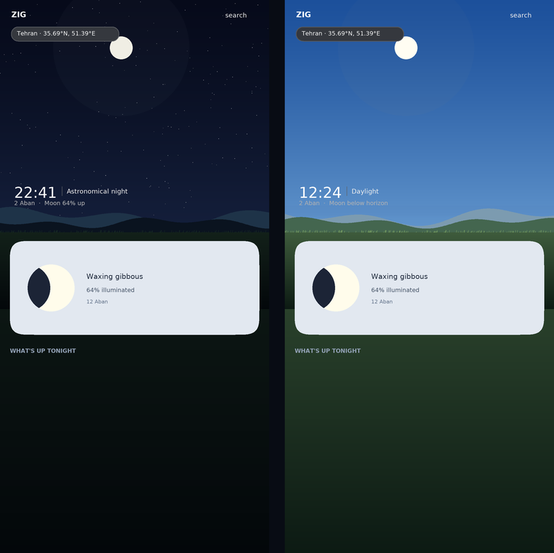

# Home Sky Scene — full-bleed hero

**Scope:** Home only. The sky canvas stopped being a card and became the top of the screen: one
edge-to-edge scene that runs behind the status bar, carries the header and the readout, and has the Moon
card riding on its lower edge. Everything else on Home starts below it.

No weather data was added. Every number and every layer is derived from what ZIG already computes:
`SkySceneFrame` (Sun, Moon, planets, stars, Milky Way), `LightingState` (Sun altitude, star visibility,
moon glow) and the scene clock.



*The same composition at astronomical night and at noon, rendered from the constants below: the same
edge-to-edge scene, the readout at caption scale above the horizon, and the Moon card in its 34 dp
squircle riding over the scene's lower edge. The clouds and the mist follow the theme; the Sun altitude
drives the light.*

---

## 1. Composition

```
┌──────────────────────────────────────────┐ 0
│  status bar (scene continues behind)     │
│  ZIG            ⌕  ⚙                     │  header (HomeScreen)
│  ◉ Tehran • 35.69°N, 51.39°E             │
│                                          │
│  22:41 │ Astronomical night              │  readout (canvas)
│  2 Aban · Moon 64% up                    │
├──────────────────────────────────────────┤ ← horizon  (0.70 × scene)
│  distant ridge · mist shelf · ridge      │
│  grass line + tufts                      │
│  ╭────────────────────────────────────╮  │ ← Moon card overlaps by 96 dp
│  │  ◗  Waxing gibbous                 │  │
│  │     64% illuminated · 12 Aban      │  │
│  ╰────────────────────────────────────╯  │
└──────────────────────────────────────────┘ scene height = 56 % of viewport
   What's Up Tonight …                      feed
```

Constants live in `SkySceneLayout` (`ui/rendering/SkySceneComposition.kt`):

| Constant | Value | Meaning |
|---|---|---|
| `HORIZON_FRACTION` | 0.70 | where altitude 0° lands inside the scene (≈ 39 % of the screen) |
| `GROUND_TOP_FRACTION` | 0.052 | solid ground starts this far below the horizon |
| `FAR_RIDGE_FRACTION` / `MID_RIDGE_FRACTION` | 0.034 / 0.020 | ridge amplitudes |

`HomeScreen` computes the height (`56 %` of the viewport, clamped to 320–600 dp) outside the
`LazyColumn`, because lazy items are measured with an unbounded height.

## 2. Layers

Drawn in `HeroSkyCanvas`, which now has three independent draw nodes:

1. **Sky** (`SkySceneRenderer.drawSky`) — atmosphere, Milky Way, stars, Sun, Moon, planets, ground.
   Repaints on the 1 Hz shared clock, or per frame while the finger scrubs time.
2. **Motion** (`SkySceneRenderer.drawSceneMotion`, scene only) — the drifting cloud veils.
   ~24 fps while idle. Separate node, so the astronomy is never repainted for a drifting cloud.
3. **Interaction** — selection ring and stardust. Only alive while the user is touching the canvas.

### Ground — `SceneGroundRenderer`

Far ridge → mist shelf → mid ridge → solid ground gradient → horizon catch-light → grass tufts →
bottom fade into the app background. Ridges are summed sines sampled with quadratics, so no polyline
shows. Grass positions are deterministic (no shimmer between ticks). Papercraft keeps hard cardstock
edges and skips the strokes; everything else gets the soft version.

### Clouds — `CloudVeilRenderer`

Three veils (high cirrus, mid, low) at different speeds and parallax depths. Pre-rendered once into
two soft alpha sprites, drawn as tinted images, so a frame costs a handful of textured quads instead
of dozens of radial gradients. Tint and strength come from `ScenePalette`: Papercraft opts out (it has
its own cut-outs), Real Sky keeps a faint veil so the photograph still moves, and the strength fades at
night so a star map is never veiled into a cloudy sky.

**These are atmosphere, not a forecast.** ZIG has no weather feed; the layer must never be described as
cloud cover.

### Readout — caption scale

The typographic block sits above the horizon on the left, at caption scale, because the scene is the
product and the instant it is drawn for is the caption:

- the clock at 26 sp medium (it used to be 46 sp light, which competed with the sky);
- a 1 dp vertical hairline separating *when* from *what*;
- the sky's own state at 11 sp;
- the date and the Moon at 10 sp, on one line.

A small accent dot appears between the hairline and the state while the finger is scrubbing time, so a
simulated instant is marked without adding a caption nobody reads mid-gesture. Every value comes from
the same state the sky is drawn from, so the numbers and the sky can never disagree.

## 3. Projection

`SkyRenderTarget.HOME_SCENE` uses `SceneProjection(SkySceneLayout.HORIZON_FRACTION)` — the same
cylindrical, equator-facing Home mapping, with the horizon as an argument instead of the 0.85 constant.
`HeroProjection` is now `SkyProjection by SceneProjection()`, so the card, the fullscreen viewer and the
Live Sky backdrop are unchanged. `SkyProjection.horizonY(w, h)` was added so every layer reads the
horizon from the surface that owns it.

## 4. Measuring it

```bash
./gradlew :app:testDebugUnitTest --tests '*SkyProjectionTest*'
```

`theFullBleedSceneMovesTheHorizonAndKeepsTheSkyMapping` asserts the horizon moved, the mapping did not,
and that the ground band sits below the horizon.

## 5. Tuning

- Taller / shorter scene: `HomeSkyHero` (0.56) and the 320–600 dp clamp.
- Sky-to-ground balance: `SkySceneLayout.HORIZON_FRACTION`.
- How much the Moon card rides up, and therefore how much ground stays visible: `cardOverlap` in
  `HomeSkyHero`. With 96 dp of a 132 dp card overlapping, the ground strip above the card is ≈ 50 dp on
  a 900 dp-tall phone and the card's lower 36 dp sits over the feed's first pixel row.
- Cloud presence per theme: `ScenePalette.cloudStrength`.
- Motion cost: `SCENE_MOTION_FRAME_MS` in `HeroSkyCanvas` (42 ms ≈ 24 fps).
