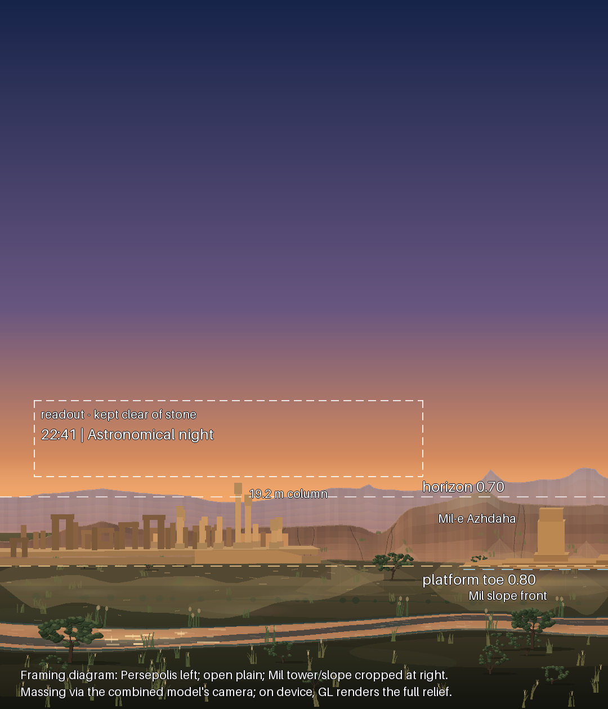

# Persepolis in the Home Landscape

**Scope:** the full-bleed Home sky scene (`HeroSkyCanvas`, `SkyCanvasPresentation.SCENE`), on the two
photographic themes. The ground band's subject is now a real place: the Apadana east façade at
Persepolis — the surviving fluted columns of the east portico on the right, the monolithic stone
door/window frames of the palace group on the left, the relief-carved east-stair cheek and the two-tier
platform across the front — rendered as a lit 3D relief by the real Sun and Moon that light the sky
behind it.

```bash
./gradlew :app:testDebugUnitTest --tests '*PersepolisFramingTest*'
python3 tools/persepolis/verify_framing.py
```



*Framing proof, not a screenshot: every frame, jamb and column from the model's element tables as a
flat block, projected with the model's fixed lookAt/ortho camera at the framing ZIG computes, over the
scene's ridges, mist and ground at 360 × 420 dp. On device the GL layer renders the full procedural
relief — fluted drums, composite capitals, relief registers, limestone grain. Regenerate with
`tools/persepolis/render_framing_preview.py`.*

---

## 1. What was integrated, and how exactly

The model arrived as one self-contained Kotlin file (`Persepolis.kt`: OpenGL ES, no assets, the
geometry generated procedurally into static VBOs — 139,517 triangles — with a fixed camera from the
south-east and all "3D behaviour" in the lighting). It now lives at
`app/src/main/java/com/alijafari/red/astronomy/ui/persepolis/Persepolis.kt`, **integrated exactly** —
same geometry builder, same element tables, same GLSL (Lambert + hemisphere ambient + specular/rim +
procedural limestone: tonal patches, grain, rain streaks, bedding planes, settled dust), same camera,
same Sun/Moon light derivation — with five changes, each recorded in the file's header note:

| # | Change | Why |
|---|---|---|
| 1 | Package line | As the file's own first line instructed |
| 2 | `PersepolisScene.init()` drops stale GL names before rebuilding | `init()` runs per fresh EGL context; Home's scene is a `LazyColumn` item, so the surface *will* be destroyed and recreated on scroll. Unpatched, the second `init()` appended a second chunk set and drew buffer names from the dead context |
| 3 | CPU mesh arrays memoised per process | `buildScene()` is deterministic (fixed LCG seed), so the arrays are bit-identical; only the VBO upload repeats per context. Scroll-back-to-top stays near-instant instead of rebuilding ~140 k triangles on the GL thread. ~7 MB retained |
| 4 | `setPreserveEGLContextOnPause(true)` | Backgrounding the app need not re-upload static VBOs where the driver keeps the context; change 2 covers the rest |
| 5 | GL calls via the ES 3.0 API on an ES 3.0 context (was ES 2.0) | The app declares ES 3.0 in its manifest and keeps every renderer on it, guarded by `AnimationRecordPrecisionTest.legacyRenderersStayOnGles3…` — which duly failed the first CI run of this change. ES 3.0 is a strict superset for everything the file calls and compiles its GLSL ES 1.00 shaders unchanged, so this is a namespace change (`GLES30`, client version 3) plus three comment updates; the shaders are byte-identical |

Hosting uses the file's **Option A** — its own `PersepolisView`, a transparent `GLSurfaceView`
(RGBA8888 + depth, `RENDERMODE_WHEN_DIRTY`) composited over the sky — wrapped by
`PersepolisLandscape` (`ui/persepolis/PersepolisLandscape.kt`) and inserted in `HeroSkyCanvas`
between the sky canvas and the cloud-motion canvas. Option B (drawing `PersepolisScene` inside a host
GL renderer) was not used: the Home sky is a Compose `Canvas`, not a GL renderer, and Option A is the
integration the file designs for exactly this situation.

**What did not change:** the Compose ground band ([`SceneGroundRenderer`](HOME_SKY_SCENE.md)) is
painted exactly as before underneath the ruin — far ridge, mist shelf, mid ridge, ground, grass —
because it is the ruin's environment: the ridges and mist are its distance backdrop, the field below
the platform toe is its foreground. The fullscreen viewer (`HOME_HERO`/`LandscapeRenderer`), the Live
Sky backdrop, and the four stylised themes are untouched.

### Theme gate

`PersepolisFeature.isEnabledFor` (mirroring `SkyPanoramaFeature`) enables the layer for **Real Sky**
(the default theme) and **Atmospheric Sky** — the two photographic themes a realistically lit
limestone relief belongs to. Papercraft, Kids Watercolor and Monochrome Scientific are deliberate flat
styles and keep their ground; Observatory exists to emit nothing but red light, and a full-colour GL
layer would defeat it. The grounding paint in the sky pass reads the same gate, so disabling the
feature removes every trace of it.

## 2. The lighting feed

No new astronomy. `SkySceneFrame` already computes, for the exact instant the sky is drawn:

- `sunHoriz` — Sun azimuth/altitude from `CoordinateEngine.equatorialToHorizontal`, azimuth measured
  **from North = 0°, East = 90°** — which is precisely the convention `PersepolisView.setSun` takes
  (its world axes are +X = north, +Z = east; `dirFromAzAlt` needs no conversion);
- `moonData` — Moon azimuth/altitude/illumination from `MoonEngine`.

`PersepolisLandscape` forwards both, with the Moon's intensity scaled by the illuminated fraction as
the file prescribes (`0.22 × fraction`, `persepolisMoonIntensity`). Colour, intensity, twilight fade
and the hemisphere ambient are derived inside `PersepolisScene.setSun` from altitude, exactly as
supplied: east faces catch sunrise, south faces noon, the group goes backlit silhouette at sunset and
dims to blue ambient + moonlight at astronomical night — in agreement with the Compose sky's own
`LightingState`, because both read the same Sun altitude.

Updates are `LaunchedEffect`s keyed on the ephemeris values, so the GL view renders **one frame per
sky-model change**: every 15 s bucket at idle (zero cost between), per frame while the finger scrubs
time (the light visibly sweeps across the façade with the sky), on location or theme change. The 24 fps
cloud clock never touches it.

## 3. Framing — `PersepolisFraming`

`ui/rendering/PersepolisFraming.kt` (pure pixel arithmetic, `SkySceneLayout` style) turns the scene
size into the view's two inputs (`visibleWidthMeters`, `baseFractionFromTop`). Rules, in priority
order:

1. **Whole façade on phones.** Visible width stays at the model's own 89 m default: the far-left ledge
   frame (x ≈ −40 m) through the lion-and-bull panel (x ≈ +43.5 m) are on screen; the 124–132 m
   platform runs off both edges as modelled.
2. **Height cap on wide scenes.** Visible width grows with aspect so the 23.6 m group never exceeds
   34 % of the scene height — no columns in the header on tablets.
3. **Platform in the ground, columns in the sky.** The toe sits at ≥ 0.84 of the scene height: the
   platform top (4.35 m) stays below the horizon (0.70), the tall columns cross it, and ~16 % of
   foreground field remains below the stone.
4. **No stone over the readout.** The GL surface composites *above* its Compose siblings, so the toe
   is pushed down (≤ 0.96) until the tallest left-hand structure — the great doorway, 14.75 m over the
   toe — clears the readout's bottom edge by 10 dp in the framing estimate. Under the model's exact
   projection the measured clearance is **+6.7…+10.7 dp** across the size matrix (§5).

Measured results (exact lookAt/ortho, `verify_framing.py`):

| Scene | Visible width | Toe at | Sky silhouette, two tall columns | Doorway vs readout |
|---|---|---|---|---|
| 320 × 380 dp | 89 m | 0.840 | 34.2 / 21.9 dp above horizon | +10.7 dp clear |
| 360 × 420 dp | 89 m | 0.840 | 39.6 / 25.7 dp | +9.5 dp |
| 430 × 480 dp | 89 m | 0.844 | 48.2 / 31.7 dp | +8.0 dp |
| 360 × 312 dp | 89 m | 0.885 | 40.7 / 26.9 dp | +8.4 dp |
| 1200 × 560 dp | 148.7 m | 0.909 | 79.2 / 51.6 dp | +6.7 dp |
| 800 × 312 dp | 178.0 m | 0.906 | 45.0 / 29.6 dp | +8.2 dp |

The framing also guarantees `PersepolisScene`'s internal `autoFitHeight` never widens the view past
the chosen width, so the scale the ground painter assumes is the scale the camera uses.

### Grounding (why it does not look pasted)

A transparent overlay ends on a hard line unless the host paints the contact. When the ruin is active,
`SkySceneRenderer` recomputes the same framing and passes the toe row to `SceneGroundRenderer`, which
adds two bands under the GL stone, after the ground gradient and before the grass:

- a **sand apron** feathering from the toe ~6 % of the scene down the field (the model itself banks
  wind-blown sand against its walls; the apron is that drift continuing onto ZIG's ground), and
- a short **contact shadow** directly in front of the forecourt edge (the file ships no shadow maps —
  correctly, for static render-on-demand geometry — so this is the host-side occlusion that seats it).

Both follow `LightingState.ambientBrightness`, so they warm, brighten and vanish into the night ground
with everything else. The exact projection puts the forecourt's front edge 1.2–2.6 dp above the toe
row — inside both bands on every tested size.

## 4. Lifecycle, cost, interaction

- `PersepolisLandscape` forwards `ON_RESUME`/`ON_PAUSE` to the `GLSurfaceView` from the composition's
  lifecycle owner (the `CompassARScreen`/`LocalLifecycleOwner` pattern) and frees the scene on the GL
  thread in `onRelease`. First surface creation runs the one procedural build on the GL thread while
  the sky and ground are already visible through the transparent surface; every later creation
  re-uploads from the memoised arrays.
- The view is non-clickable/non-focusable and consumes no touches: tap-to-identify and finger time
  travel on the canvas are unaffected (its geometry is not hit-tested — a tap on a star projected over
  a column still identifies the star).
- Per-repaint cost is the file's own: three static-VBO draw calls, on demand. At idle that is one
  frame per 15 s model bucket; the surface does no work between light changes.

### Known trade-offs (honest list)

- **Surface above siblings.** `setZOrderOnTop` places the GL surface above the Compose layers inside
  its bounds. Framing (§3.4) keeps stone off the readout and header; what remains beneath is where it
  belongs physically — cloud veils drift behind the columns, and a near-horizon selection ring is
  occluded by the stone that occludes its object. If that ever stops being acceptable, the upgrade
  path is the file's Option B: host the untouched `PersepolisScene` on a `TextureView` the way
  `SkyPanoramaSurfaceView` hosts the panorama, gaining true Compose z-order at the cost of a
  hand-rolled EGL thread. The scene's `RectangleShape` clip is why the surface needs no clipping here,
  unlike the panorama's squircle card.
- **Scroll.** The scene is the first `LazyColumn` item; a `SurfaceView` layer follows its window
  position per frame on current Android, but can lag a frame behind fast flings on some devices.
  The TextureView path above removes that too.
- **Fixed view.** One camera, from the south-east, telephoto-compressed like the reference photograph
  (the file's header documents the scope: plan-true sizes, ~24 m compressed depth). It does not orbit,
  and it is not tied to the observer's location — Persepolis is the scene's *place*, the way the
  ridge line was, now with the Sun and Moon of the observer's own sky moving across it. It must not
  be described as the view from the user's location.
- **No cast shadows.** Depth occlusion is real; column-on-platform shadows would need a shadow-map
  pass around `PersepolisScene.draw`, which the geometry already allows if it is ever wanted.

## 5. Verification

- `PersepolisFramingTest` (JVM): the four framing rules over six scene sizes, the theme gate, and the
  moonlight scaling.
- `tools/persepolis/verify_framing.py` (stdlib): replicates `Matrix.setLookAtM`/`orthoM` and
  `PersepolisScene.draw`'s centre-solving, projects eleven landmark world points (toe, forecourt edge,
  platform top, both tall columns, doorway cornice and corner, façade ends) through the framing, and
  asserts the composition — including the one direction where the isotropic estimate is *not*
  conservative (a structure 11 m behind the toe projects higher). Measured approximation error:
  ≤ 5.8 dp (tablet column top), ≤ 3.3 dp at the doorway, covered by the 10 dp clearance.
- `tools/persepolis/render_framing_preview.py` (Pillow): regenerates the diagram above.
- The GL code itself needs a device or emulator: `assembleDebug`, open Home on Real Sky, scrub time
  across sunrise/noon/sunset/night, scroll the feed away and back (surface recreation via change 2/3),
  background and resume the app, switch to Papercraft and back (gate).

## 6. Tuning

- On/off and themes: `PersepolisFeature` (`ui/persepolis/PersepolisLandscape.kt`).
- Façade width vs building size, toe position, readout clearance: `PersepolisFraming` constants.
- Sand/shadow strength and reach: `SceneGroundRenderer.drawPersepolisGrounding`.
- Light character (colour ramp, exposure): inside `Persepolis.kt` (`PersepolisScene.setSun`, the
  fragment shader) — changing these changes the supplied model, prefer the host-side knobs.
