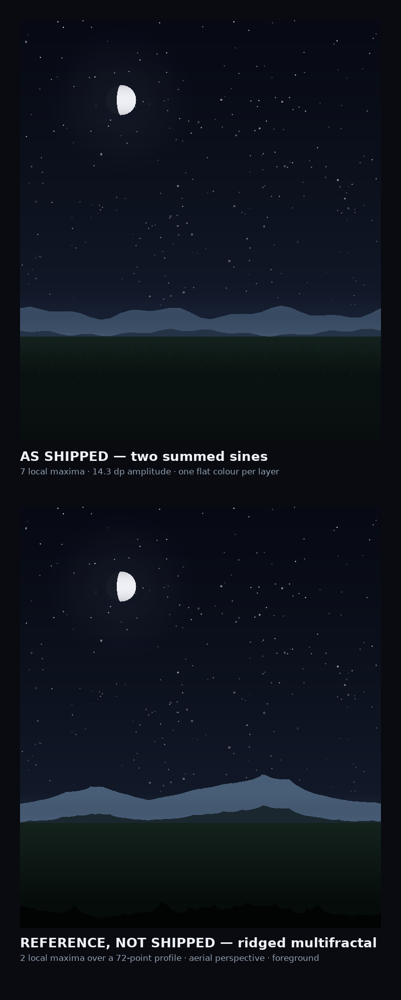

# The Home Landscape — what it is now, and the honest answer on making it real

**Scope:** the ground half of the full-bleed Home scene — everything below the horizon in
`HeroSkyCanvas`. This is a research and recommendation document. It changes no drawing code beyond one
defect it records in §2.4, and it deliberately does not commit to a photo.

**Verdict up front:** "replace the landscape with a photo" is the *weakest* of the five available
options, and it is the one that would age worst. The strongest option is also the one that is most
special, and it is not a picture at all: **compute the real horizon of the user's own location from a
Digital Elevation Model, ship the resulting profiles in the APK, and draw the silhouette from that.**
That is a few tens of kilobytes, it makes the sky provably *this place* rather than a decoration, and it
is the only option that also improves what the app says — which objects are actually visible tonight.
Details, costs and failure modes in §5–§7.

---

## 1. What Home draws today

Exact inventory, from `SceneGroundRenderer.draw` (about 230 lines) and `SkySceneLayout`
(`ui/rendering/SkySceneComposition.kt`). The composition is pure arithmetic on the canvas size, so all
of it is unit-testable on the JVM.

| # | Layer | Code | Geometry |
|---|---|---|---|
| 1 | Far ridge | `ridgePath(...)` ×1 | 36 quadratic-smoothed samples, amplitude `0.034 h` (14.3 dp on a 420 dp scene) |
| 2 | Mist shelf | `drawRect` + vertical gradient | band from `horizon − 0.055 h` to `horizon + 0.045 h`, peak alpha 0.30 |
| 3 | Mid ridge | `ridgePath(...)` ×1 | 36 samples, amplitude `0.020 h` (8.4 dp) |
| 4 | Solid ground | `drawRect` + vertical gradient | from `groundTopY = horizon + 0.052 h` to the bottom |
| 5 | Horizon catch-light | `drawRect` + gradient | 0.06 h tall, alpha 0.10–0.28 driven by Sun altitude |
| 6 | Grass line | `drawGrass` | 96 tufts of 2 strokes each, 0.8–2.2 % of `h` tall |
| 7 | Foot vignette | `drawRect` + gradient | from `0.90 h` to the bottom, to 26 % black |

Horizon at `0.70` of the scene; the scene is `0.52` of the viewport (312–560 dp), so altitude 0° lands
at about 36 % of the screen. Total cost: three filled paths, six gradient rectangles, up to 192 line
segments. It is redrawn with the sky node — 1 Hz idle, or per frame while a finger scrubs time — and
never on the cloud node's ~24 fps pass. In other words the ground is currently cheap enough that it is
effectively free, which is worth remembering when comparing options in §4.

---

## 2. The silhouette, measured

### 2.1 The formula

Both ridgelines are the same function of one variable:

```kotlin
height(p) = ((0.65 · sin(2π·waves·p + φ) + 0.35 · sin(2π·detail·p + 1.7φ)) / 2 + 0.5) · amplitude
```

- far: `waves = 3`, `detail = 7`, `φ = 0.6`
- mid: `waves = 2`, `detail = 9`, `φ = 2.1`

36 samples across the width, chained with `quadraticTo(control = previous sample, end = midpoint)`, so
the polyline never shows.

### 2.2 What that silhouette actually looks like

Sampling the shipped constants at 3600 points:

| Ridge | Local maxima across one screen width | Range of the height term | Peak-to-trough |
|---|---|---|---|
| far | **7** | 0.003 – 0.997 | 14.2 dp |
| mid | **9** | 0.010 – 0.999 | 8.4 dp |

So the skyline crosses its own baseline about seven to nine times per screen, and every one of those
maxima reaches essentially the full amplitude. That is the whole diagnosis, and it is geometric, not a
matter of taste:

- **No dominant peak.** Real terrain seen from the ground is a *skyline with order*: one or two shapes
  that own the horizon, a shoulder, then lower ground. A wave with seven equal peaks has no order, which
  is why the eye reads it as a pattern rather than a place — and why "it looks like a photo" is the
  *generous* reading; the accurate one is "it looks like wallpaper".
- **No scale hierarchy.** The only two frequencies are 3 and 7 cycles per screen. Terrain that reads as
  real needs roughly a 1/f spectrum across at least 5–6 octaves: a big mass, ridges on the mass,
  gullies on the ridges, scree on the gullies.
- **No erosion.** Summed sines are symmetric up and down. Mountains are not: they are steep where rock
  fails and shallow where debris piles up, which is what `(1 − |noise|)²` — ridged multifractal noise —
  reproduces for free.
- **No aerial perspective.** Both ridges are painted in flat, theme-derived colours and separated only by
  one mist band. Real distance reads through *contrast loss and a hue shift toward the horizon colour*,
  not through a single translucent stripe. This is the cheapest single improvement available: see §5.2.
- **The ground is a rectangle.** Under the mid ridge there is a linear vertical gradient and the grass
  line. There is no foreground — no near ground plane, no scale reference, nothing that tells the eye
  how far away the ridge is.

### 2.3 It never changes

The composition is a pure function of the canvas size and the theme. It does not depend on the user's
location, the season, the Sun's azimuth, the time of day, or the date. Two users 2000 km apart see the
same mountains. In an app whose entire claim is *"this is your sky, now"*, that is the largest single
inconsistency in the visual design — the sky above is computed, the ground below is decoration.

### 2.4 A defect found while measuring (fixed with this document)

`SceneGroundRenderer.pseudoRandom` masks a hash to `0 .. 2^31−1` and then divides by `2^24−1`, so it
returns values in `0 .. 128` instead of `0 .. 1`. Its only caller, `drawGrass`, uses it for the tuft's
horizontal position and its depth below the grass line:

```kotlin
x      = width * ((i + r1 * 0.9f) / tufts)      // r1 up to ~127 → x up to ~2.2 × width
depth  = r2 * height * 0.11f                    // r2 up to ~127 → up to 14 × height below the line
```

Counted over the real 96 tufts at 360 × 420: **1 of the 96 lands on the canvas.** The documented "grass
line + tufts", the layer that is supposed to give the ground a scale, has been effectively absent. The
divisor is now `2_147_483_648f`, which is what the mask implies, and all 96 tufts land where the code
intended. The comment on that function now says so, because the constant looks arbitrary and the
silhouette of the ground changes if anyone "tidies" it.

This is worth stating plainly in a report about realism: the current landscape is not only too simple,
part of it was not being drawn.

---

## 3. "Realistic" and "special" are two different problems

They are usually asked for in one breath and they have almost nothing in common.

| Property | What it means visually | How it is obtained | Does a photo provide it? |
|---|---|---|---|
| Physical realism | haze, contrast falloff, correct light on the land | aerial perspective model + lighting state | **Yes**, baked in for one light |
| Depth | foreground / midground / background separation | 2–3 parallax layers, scale hierarchy | Only with a layered matte, not one flat image |
| Belonging to the place | it is *your* horizon | real elevation data, or a real photograph of that place | Only if it is a photo of *that* place |
| Response to time | the land darkens, warms, silhouettes at sunset | palette driven by Sun altitude and azimuth | **No** — a photo is frozen at one light |
| Motion | clouds, haze drift, parallax with the sky | procedural layers | No |
| Astronomical meaning | the horizon *occludes* — a 3° ridge hides a rising star for ~12 minutes | horizon profile fed to the visibility engine | No, unless converted to a profile anyway |

The last row is the one nobody expects and it is where the app can do something a wallpaper cannot. ZIG
currently decides visibility with `altitudeDeg > 0.0` (`ObservabilityEngine`), i.e. a perfectly flat
horizon everywhere on Earth. Nurabad sits in the Zagros; a 5° ridge to the south there delays a rising
object by roughly 20 minutes and hides low objects entirely. A real horizon profile turns the landscape
from scenery into an input.

Two consequences for the brief:

1. A photo is the fastest way to buy *one* of the six rows (physical realism), for one light, for one
   place, and it makes the other five strictly worse than they are now.
2. The only option that scores on four or five rows at once is the one that starts from elevation data.

---

## 4. The five options, costed

Effort is the honest estimate for this codebase (a Kotlin/Compose app with no image pipeline, no
network layer for assets, and a 1100-test suite that must stay green). Frame cost is per repaint of the
sky node.

| | Option | Effort | APK cost | Frame cost | Realism | "Special" | Time response | Risk |
|---|---|---|---|---|---|---|---|---|
| A | One photograph / panorama | 1–2 d | 1.5–3 MB (4k JPEG) to 6–10 MB (8k) | decode + 1 draw | High, frozen | Depends on the photo | **None** | Licensing, resolution per density, one light |
| B | Photograph + procedural sky and haze | 1–2 w | as A | as A + haze pass | High | Depends | Partial (haze only) | Same as A |
| C | Layered painted mattes (2–3 alpha cutouts) | 3–5 d | 300–900 KB (WebP q80) | 3 bitmap draws | Medium-high | Artist's choice | **Full** (per-layer palette) | Needs art; parallax must be bounded or it looks like a diorama |
| D | Procedural upgrade: ridged fBm + erosion + aerial perspective | 3–4 d | **0** | ~0.3–0.8 ms extra | Medium-high | Seedable per location | **Full** | Tuning by hand; "procedural" can read as generic if the spectrum is wrong |
| E | Real horizon profile from a DEM, drawn as the silhouette | 5–8 d | **~20–40 KB** | negligible | Medium (silhouette only) | **Absolute** — it is the user's own horizon | **Full** | Data licensing, coverage, custom coordinates |

Option E's APK number is not a guess: `GeoLocationCatalog` ships **294** cities. A horizon profile at 5°
resolution is 72 values; stored as one byte per value at 0.25° quantisation that is **72 bytes per
city**, i.e. ~21 KB, plus a few hundred bytes of index. Even at 1° resolution and two bytes per value it
is under 60 KB. This is the cheapest *meaningful* upgrade in the list by two orders of magnitude.

---

## 5. Why the photo is the weakest option (the part that needs saying)

The brief describes the current landscape as "just a photo". It is worth separating two readings of
that, because they lead to opposite conclusions.

**Reading 1 — "it looks like a photo, i.e. flat and inert."** Correct, and §2 explains why: no scale
hierarchy, no erosion, no aerial perspective, and a foreground layer that was not being drawn. Nothing
in that list requires a photograph to fix; all of it is fixable procedurally (§7).

**Reading 2 — "replace it with a photograph so it becomes realistic."** This is the option to be honest
about, and it fails on its own terms:

1. **A photograph is a single lighting condition.** Home's ground is currently tinted from
   `LightingState` — it darkens at dusk and takes the horizon tone at sunset. A JPEG cannot: at 21:00 the
   app would be showing a hillside lit by midday sun, directly under a sky the app itself has drawn as
   night. The mismatch is more visible than the added realism.
2. **A single image cannot respond to the sky above it.** Rain-free haze, moonlit rim light, the
   afterglow azimuth — all of it would have to be baked in.
3. **It has to agree with the horizon line.** The scene's horizon is a computed constant
   (`HORIZON_FRACTION = 0.70`), and every star, planet and the Moon are projected against it. A photo's
   ridgeline arrives wherever the photographer stood: unless the image is cropped and shifted so its
   skyline lands exactly on `0.70 h` for every aspect ratio the app can produce (phone portrait, tablet,
   the landscape fullscreen viewer), the astronomy is drawn against a horizon that is not the one in the
   picture. Doing that per aspect ratio means either several crops or a letterbox, and both look like a
   screenshot of a photograph rather than a scene.
4. **It is one place.** Whichever mountain range is chosen, it is wrong for 294 cities — the exact
   problem the landscape already has, only now with a specific, wrong answer.
5. **Memory and decode.** A 1080 × 1440 background at 3× density wants roughly 6 MB of bitmap
   (1080×1440×4 B) plus a decode on the main thread unless it is preloaded and cached; the scene already
   runs a 1 Hz repaint and a 24 fps cloud pass, and the ground is currently free.
6. **Licensing.** It is solvable — [Poly Haven](https://polyhaven.com/license) publishes its HDRIs and
   textures as CC0 (no attribution, commercial use, redistribution allowed), and ambientCG does the
   same — but a CC0 *panorama of a generic mountain range* is the definition of a landscape that is not
   yours, which is the "special" half of the brief going unmet anyway.
7. **It ends the conversation.** Once the ground is a JPEG, every later improvement (parallax, time
   response, occlusion-aware visibility) is blocked behind "we would have to take a new photograph".

None of this argues that photographs are bad in a sky app. It argues that a photograph is the right tool
for **one** job — showing a real place — and this screen's job is "your sky, now, from where you stand".

---

## 6. What "realistic" actually requires (measures, not adjectives)

If the goal is a landscape that survives a critical look, these are the specific properties to hit. They
are listed as measurable acceptance criteria because "looks realistic" is not testable and these are.

1. **Spectral hierarchy.** The silhouette's height field must have energy across at least 5 octaves with
   a `1/f^β`, `β ≈ 1.0–1.2` falloff, and one octave must dominate (the massif). Test: FFT of the sampled
   height field; assert the energy ratio between the 1st and 2nd octaves > 2:1 and that no more than
   ~25 % of the energy sits in the top octave (which would read as noise).
2. **Ridged, not sinusoidal.** Ridge lines should be sharp at the top and smooth at the bottom — a
   property of `(1 − |noise|)²` sums, not of `sin`.
3. **Aerial perspective.** Contrast must fall and the colour must move toward the horizon hue with
   distance. The physical model is scattering along the line of sight (Koschmieder:
   `C(z) = C(0)·e^(−βz)`, with Rayleigh scattering giving the blue shift); the practical version is
   one lerp toward `LightingState.horizonTone` with a per-layer strength (0.15 / 0.35 / 0.6). Test:
   assert that the far layer's contrast against the sky is lower than the mid layer's, in every theme.
4. **Scale reference.** Something in the extreme foreground must establish distance (a foreground ridge
   edge, a tree line, a rock edge), or the mid ridge floats. This is what the broken grass line was for.
5. **Light response.** Every ground colour must be derived from `LightingState` (Sun altitude and
   azimuth), so the land cannot be midday-lit under a night sky. The code already does this for the
   catch-light and the ground gradient; the ridges should follow.
6. **Agreement with the projection.** The silhouette must end exactly on `horizonY` in every
   presentation (`HOME_SCENE`, landscape fullscreen, tablet), because the astronomy is projected against
   that line.

---

## 7. Recommendation

### 7.1 The answer

**Build E, dressed by D, framed by C-at-the-end.** In order:

**Stage 1 — a real horizon profile (the special part, and the honest part).**
Offline, for each of the 294 cities in `GeoLocationCatalog`, sample a DEM along 72 azimuths and keep the
maximum elevation angle per azimuth, corrected for Earth curvature and refraction:

```
angle(az) = max over d of atan( (h(d, az) − h0 − d²(1−k)/(2R)) / d )
```

with `R = 6 371 km` and `k ≈ 0.13` for standard refraction — the same recipe as GRASS `r.horizon` and as
the published Python/`rasterio` workflow ([spatialworkflow.io](https://www.spatialworkflow.io/horizon-profile-from-dem-python/),
[GRASS r.horizon](https://grass.osgeo.org/grass78/manuals/r.horizon.html)). Free global DEMs cover every
city in the catalogue: [Copernicus GLO-30](https://www.spatialworkflow.io/horizon-profile-from-dem-python/)
(30 m, global, no key) or [SRTM 1″/3″](https://www.usgs.gov/centers/eros/science/usgs-eros-archive-digital-elevation-shuttle-radar-topography-mission-srtm)
(30 m between 60°N and 56°S — note the latitude limit, which is why Copernicus is the better base).

Deliverable: `HorizonProfiles.kt` (or a generated binary asset) of 294 × 72 bytes, an `HorizonProfile`
value type, and:

- `SceneGroundRenderer` draws the silhouette **from the profile** (72 points is already more detail than
  the current 36);
- `ObservabilityEngine` gains a horizon-aware visibility path, so "visible tonight" means *visible over
  your ridge*, not over an imaginary sea horizon. This is a real product improvement and it is what
  makes the work worth doing beyond the picture.

Custom coordinates (a user can type their own lat/lon) have no profile: fall back to the nearest catalog
city's profile scaled by nothing, or to the procedural one — and say so in the UI, quietly.

**Stage 2 — make the profile look like land, not like a bar chart (the realistic part).**
A 5°-sampled horizon profile is a plausible skyline but has no texture. Add, in this order:

1. **Ridged multifractal detail** on top of the profile, 4–5 octaves, amplitude weighted by the local
   profile height so the detail rides on the massif and dies in the valleys:
   `e = Σ 2^−i · ridge(2^i·p) · e_{i−1}` where `ridge(n) = (1 − |n|)²`. This is Musgrave's construction;
   [Red Blob Games](https://www.redblobgames.com/maps/terrain-from-noise/) has the working form and
   [afluidity](https://afluidity.com/algorithm-atlas/algorithms/ridged-multifractal-noise/) the formula.
2. **Aerial perspective** per layer: lerp toward `horizonTone` by 0.15 / 0.35 / 0.6 and drop contrast
   with distance (Koschmieder; see [Wikipedia: aerial perspective](https://en.wikipedia.org/wiki/Aerial_perspective)).
   This is the single change that does the most for "real" per line of code.
3. **A foreground band**: the grass line, fixed (see §2.4), plus a near-edge silhouette that anchors the
   bottom of the frame.

**Stage 3 — only if the result still feels like a poster.** Split the ground into 2–3 painted mattes
(option C) so the foreground can move against the sky. Ten to twenty pixels of parallax is the usual
amount; more turns the scene into a diorama and fights the flat glass UI. Do this *after* the silhouette
is right, because parallax on a wrong skyline just moves the wrong thing.

**Do not do this: ship a photograph.** If a photograph is ever required — a "this is Tehran from
Milad Tower" tile, say — it belongs in an optional, per-location "Real Sky" card with its own credit and
its own time-of-day variants, not as the ground of the main screen.

### 7.2 Sequencing, in file terms

| Step | Files | Notes |
|---|---|---|
| 1 | `data/catalog/HorizonProfiles.kt` (new, generated) | generated by an offline script; ~21 KB; deterministic |
| 2 | `domain/Models.kt` (`HorizonProfile`) | value type + `u(az)` lookup with interpolation |
| 3 | `ui/rendering/SceneGroundRenderer.kt` | replace `ridgePath` input with profile points; keep the mist and gradients |
| 4 | `astro_engine/ObservabilityEngine.kt` | `altitudeDeg > horizon(az)` instead of `> 0` |
| 5 | `app/src/test/.../HorizonProfileTest.kt` (new) | monotonic total, 0 ≤ angle ≤ 89, known-city spot checks |
| 6 | `docs/HOME_SKY_SCENE.md` | update the ground section |

### 7.3 What could go wrong (honestly)

- **DEM vertical error.** SRTM is ±16 m (90 %); at 5 km that is 0.2°, at 1 km it is 0.9°. Good enough for
  a skyline, not for deciding whether a star is occluded at 0.1° resolution. Quote the accuracy, do not
  fake it.
- **What a DEM does not contain.** Trees, buildings, the neighbour's wall. A horizon profile is *bare
  earth plus canopy-free terrain*. In a city the real horizon is higher than the model. Say so.
- **Sampling resolution.** 5° is coarse for a skyline. 72 values over 360° will make a narrow valley
  disappear; 1° (360 bytes/city, ~105 KB total) is the honest step if size allows.
- **The custom-coordinate case.** Any location the user types by hand has no profile. The fallback must
  be decided up front, because it is the case that will look wrong.
- **Effort is in the pipeline, not the drawing.** The 5–8 day estimate is dominated by building the
  offline DEM sampling and validating it against a known skyline (e.g. compare Nurabad's profile against
  a photograph of the Zagros from that town). The Kotlin side is small.

---

## 8. Appendix — the silhouette as it stands



The figure draws the *shipped* composition from the constants in §1 at 360 × 420 dp, and directly
beneath it the same stack rebuilt with a ridged-multifractal silhouette and per-layer aerial
perspective — the same frame, so the difference is the silhouette, not the colour script. The ridge
alphas are lifted and the foot of the ground is lightened for print; the geometry, the amplitudes and
the horizon are the shipped ones. The lower panel is an illustration of options D/E, not a proposal
already implemented.

Reading it left to right, the current skyline reaches its baseline seven times; the reference reaches its
baseline twice, and its mass sits in one place. That, more than any colour choice, is the difference
between "a landscape" and "a photograph of one".

---

## Sources

- Ridged multifractal noise: formula and behaviour — [Red Blob Games, *Making maps with noise functions*](https://www.redblobgames.com/maps/terrain-from-noise/); [Afluidity, *Ridged Multifractal Noise*](https://afluidity.com/algorithm-atlas/algorithms/ridged-multifractal-noise/).
- fBm with derivatives / pseudo-erosion — [Inigo Quilez, *Noise derivatives*](https://iquilezles.org/articles/morenoise/).
- Horizon profile from a DEM, with curvature and refraction correction (`k ≈ 0.13`) — [spatialworkflow.io, *How to compute a horizon profile from a DEM in Python*](https://www.spatialworkflow.io/horizon-profile-from-dem-python/); [GRASS GIS `r.horizon`](https://grass.osgeo.org/grass78/manuals/r.horizon.html).
- Elevation data: [Copernicus GLO-30 (30 m, global)](https://www.spatialworkflow.io/horizon-profile-from-dem-python/); [USGS SRTM (30 m, 60°N–56°S)](https://www.usgs.gov/centers/eros/science/usgs-eros-archive-digital-elevation-shuttle-radar-topography-mission-srtm).
- Aerial perspective / contrast loss with distance — [Wikipedia, *Aerial perspective*](https://en.wikipedia.org/wiki/Aerial_perspective); Koschmieder's law.
- Photo licensing, if a photograph is ever used — [Poly Haven asset licence (CC0)](https://polyhaven.com/license).
